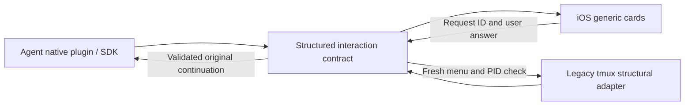

# Structured interaction adapters

## Diagnosis and decision — 2026-10-15

Read-only inspection of the original `test` session found real menus in all three panes. Codex had already advanced from model selection to reasoning intensity. At 46–47 columns, descriptions wrap across rows; Claude's first option/title was clipped. Pi's 23-row pane showed a search field and ten of seventy models, with its bottom help clipped. The previous parser required adjacent option rows and Pi's complete English help. Screenshots therefore showed an accepted `/model` message followed by a disabled composer, with no choice card.

Use **native plugin data first**, with a structural tmux adapter for sessions without a usable plugin. A terminal capture has no authoritative control tree: a plugin cannot automatically attach to every arbitrary pre-existing dialog. Do not claim universal native support or replace a live process with a separately resumed session.

## Native provider findings

| Provider / locally inspected version | Native path | Boundary |
| --- | --- | --- |
| Codex 0.162.1 | `model/list` advertises each model's reasoning options; `thread/settings/update` accepts model/effort for subsequent turns of the exact live thread. Existing PermissionRequest hooks return explicit decisions. | The settings method is experimental. Requires the shared daemon and trusted plugin hooks. This control connection does not own every interactive request emitted to the original TUI. |
| Claude Code 2.1.287 | PermissionRequest hooks return allow/deny. PreToolUse receives structured AskUserQuestion inputs and can return answers in `updatedInput`. Channels provide an alternative permission transport. | Use one permission transport per session. MCP Channel alone is not an API for every built-in model picker. Network permission requests do not all fire PermissionRequest. |
| Pi 1.2.0 | Same-process extension exposes model registry/setModel. Public select/confirm/input calls carry title/options and support AbortSignal. | Capturing a built-in `/model` screen is different from handling an extension's SDK dialog. Custom UI/editor components do not expose the same dismissible contract. |

The Codex fields/methods were also checked against JSON Schema generated by the installed binary, without starting a model turn. Reasoning IDs and their order come from the provider; new strings do not require a mobile release. See [Codex model discovery](https://learn.chatgpt.com/docs/app-server#models) and [upstream protocol](https://github.com/openai/codex/tree/main/codex-rs/app-server-protocol).

Claude's native question/permission mappings follow the [documented hook schemas](https://code.claude.com/docs/en/hooks#tools-that-require-user-interaction). Hooks keep the original call pending; timeout/disconnect returns no decision and preserves local handling. The phone never invents approval from message wording.

Claude's **Mods API**, available from CLI 2.1.287, is the next route to investigate for a fully native configuration surface: it exposes configuration list/set, command inventory, question render sites and event continuations. Read the exact build's generated type declarations before implementing it. The published render-site list does not promise access to all built-in pickers. Mods support does not mean every internal dialog is exported. [Mods overview](https://code.claude.com/docs/en/plugins/mods/overview), [API/reference](https://code.claude.com/docs/en/plugins/mods/reference).

Pi's adapter mirrors public SDK dialogs, leaves the original Mac dialog open, and resolves its original continuation once. A phone answer aborts the Mac dialog through its documented signal. Mac answers, timeouts and cancellation remove the pending card and reject late replies. Unsupported custom dialogs show a non-actionable card. See [Pi extensions](https://github.com/earendil-works/pi/blob/main/packages/coding-agent/docs/extensions.md).

## Contract and extensibility

Native adapters publish existing question/approval forms containing IDs, titles, options, multiplicity and input metadata. Responses refer to the pending request ID, and are validated against its stored schema. A provider adapter translates the result back into its native continuation. The mobile renderer knows UI primitives, not tool names, model names or approval phrases.

The terminal compatibility contract is versioned `interaction.schema = 1`. It contains options, selected focus, server-advertised actions, optional search/query and `visible_only`. Changing focus or moving to a second dialog changes the ID. Every action rechecks menu identity and the original Agent PID. Selection navigates; confirmation remains explicit. Raw key strings from clients are not executed.

`src/interaction-profiles.json` registers structural styles. Detection groups numbered headers through indented continuations, or uses a bounded search/border/arrow container. It does not branch on `/model`, thinking labels, tools or permission wording. Additional local profiles can be prepended with `AGENTMUX_UI_PROFILES=/absolute/path/profiles.json`; schema validation occurs at startup. Profiles are trusted local configuration, not remotely editable rules. Search and adjacent navigation allow access beyond the visible subset without inventing hidden options.

For a new provider: implement a native adapter with truthful capabilities, map its requests into the shared primitives, validate answers and resolve only the matching continuation. Add protocol fixtures with previously unseen labels. Terminal theme changes normally need profile data rather than a mobile renderer change. Unsupported controls remain local.

## Verification and remaining work

- Saved menu-only fixtures from all three original narrow panes; real `test` panes were inspected using GET/read-only tmux capture only.
- Three-provider isolated tmux acceptance includes Codex's two-stage model → intensity workflow and advertised session-only action, permission confirmation, stale IDs, invalid actions and original process identity.
- Packaged Claude hook fixture answers arbitrary questions and preserves original inputs; Codex fixture verifies dynamically advertised effort and exact-thread settings update.
- Pi SDK fixture covers arbitrary select/confirm/input, Mac/mobile races, signal cancellation and stale IDs. Real installed Pi also completes these dialogs through the Rust API in an isolated offline tmux process, preserving its PID and dismissing the original Mac UI.

No user Agent received test input or was restarted. No model requests were sent. Live Codex settings/approval behavior and Claude hook execution during an actual provider turn still need validation; fixture/schema success is not that proof. Claude Mods configuration integration remains research, not shipped functionality. Real iPhone keyboard/card interaction remains unverified.
